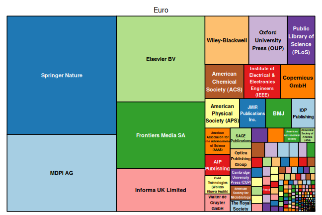
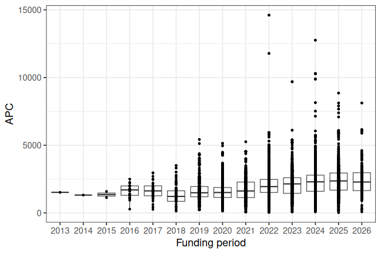
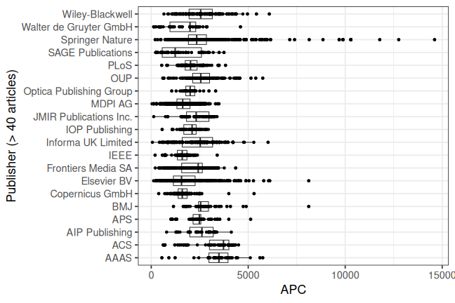

The [CSC – IT Center for Science](https://csc.fi/en/) has updated its data, providing more APC data for Finnish HEIs.

The CSC is a non-profit government enterprise which provides IT support and services to Finnish academia and research institutes. It operates [VIRTA](https://wiki.eduuni.fi/display/cscvirtajtp/VIRTA+in+English), a centralized service tasked with collecting publication data from HEIs. VIRTA may also optionally collect cost data on OA publishing (APCs and BPCs), this data is made available to OpenAPC where permission was granted by the data providers.

Contact Person for the CSC is [Ville Hämäläinen](mailto:virta-julkaisutietopalvelu@csc.fi).

## Cost data

The updated data set provided by the CSC covers publication fees for 6,266 articles published between 2013 and 2026, replacing the previous CSC data. Total expenditure amounts to 12,945,666€ and the average fee is 2,066€.

|                                                                               | Articles| Fees paid in EURO| Mean Fee paid|
|:------------------------------------------------------------------------------|--------:|-----------------:|-------------:|
|MDPI AG                                                                        |     1098|           1815504|          1653|
|Springer Nature                                                                |     1076|           2785011|          2588|
|Elsevier BV                                                                    |      927|           1634080|          1763|
|Frontiers Media SA                                                             |      597|           1270381|          2128|
|Informa UK Limited                                                             |      344|            815754|          2371|
|Institute of Electrical & Electronics Engineers (IEEE)                         |      178|            269899|          1516|
|Wiley-Blackwell                                                                |      173|            456318|          2638|
|Copernicus GmbH                                                                |      152|            252161|          1659|
|Oxford University Press (OUP)                                                  |      152|            403105|          2652|
|Public Library of Science (PLoS)                                               |      139|            287020|          2065|
|American Physical Society (APS)                                                |       94|            218550|          2325|
|American Chemical Society (ACS)                                                |       87|            285834|          3285|
|IOP Publishing                                                                 |       73|            147992|          2027|
|JMIR Publications Inc.                                                         |       71|            164376|          2315|
|SAGE Publications                                                              |       62|             94210|          1520|
|BMJ                                                                            |       59|            163985|          2779|
|Walter de Gruyter GmbH                                                         |       59|             95229|          1614|
|AIP Publishing                                                                 |       45|            114705|          2549|
|Optica Publishing Group                                                        |       45|             90601|          2013|
|American Association for the Advancement of Science (AAAS)                     |       42|            144543|          3442|
|BioResources                                                                   |       32|             42103|          1316|
|Cambridge University Press (CUP)                                               |       32|             76744|          2398|
|Ovid Technologies (Wolters Kluwer Health)                                      |       29|             99272|          3423|
|American Society for Microbiology                                              |       27|             66000|          2444|
|The Royal Society                                                              |       27|             51303|          1900|
|Finnish Society of Forest Science                                              |       26|             22911|           881|
|Acoustical Society of America (ASA)                                            |       22|             46057|          2094|
|American Astronomical Society                                                  |       21|             49026|          2335|
|Association for Computing Machinery (ACM)                                      |       20|             19034|           952|
|Royal Society of Chemistry (RSC)                                               |       20|             25321|          1266|
|Pensoft Publishers                                                             |       18|             18868|          1048|
|Ubiquity Press, Ltd.                                                           |       18|             18563|          1031|
|Audio Engineering Society                                                      |       15|             14990|           999|
|Proceedings of the National Academy of Sciences                                |       14|             50476|          3605|
|EDP Sciences                                                                   |       11|             12205|          1110|
|Society for Neuroscience                                                       |       11|             42340|          3849|
|Canadian Science Publishing                                                    |       10|             36066|          3607|
|MJS Publishing, Medical Journals Sweden AB                                     |       10|             18791|          1879|
|American Geophysical Union (AGU)                                               |        9|             20993|          2333|
|American Physiological Society                                                 |        9|             25748|          2861|
|Association for Research in Vision and Ophthalmology (ARVO)                    |        9|             15531|          1726|
|PeerJ                                                                          |        9|             15227|          1692|
|Stockholm University Press                                                     |        9|              6184|           687|
|American Association for Cancer Research (AACR)                                |        8|             49971|          6246|
|American Medical Association (AMA)                                             |        8|             27062|          3383|
|Cogitatio                                                                      |        8|              9826|          1228|
|eLife Sciences Publications, Ltd                                               |        8|             21860|          2732|
|IWA Publishing                                                                 |        8|             16206|          2026|
|The Company of Biologists                                                      |        8|             29872|          3734|
|Det Kgl. Bibliotek/Royal Danish Library                                        |        7|              3756|           537|
|Emerald                                                                        |        7|             18966|          2709|
|International Association of Online Engineering (IAOE)                         |        7|              4242|           606|
|MIT Press                                                                      |        7|             11344|          1621|
|American Society of Hematology                                                 |        6|             18038|          3006|
|AOSIS                                                                          |        6|              4743|           790|
|Cappelen Damm AS - Cappelen Damm Akademisk                                     |        6|              5173|           862|
|Georg Thieme Verlag KG                                                         |        6|             15879|          2646|
|Human Kinetics                                                                 |        6|             14381|          2397|
|Mary Ann Liebert Inc                                                           |        6|             19424|          3237|
|American Society of Civil Engineers (ASCE)                                     |        5|              9654|          1931|
|Bristol University Press                                                       |        5|              8920|          1784|
|Inderscience Publishers                                                        |        5|             10143|          2029|
|Intellect                                                                      |        5|              7977|          1595|
|Termedia Sp. z.o.o.                                                            |        5|              2600|           520|
|Virtus Interpress                                                              |        5|              2780|           556|
|American Psychological Association (APA)                                       |        4|             11538|          2884|
|E.U. European Publishing                                                       |        4|              8100|          2025|
|Institute of Mathematical Statistics                                           |        4|              2887|           722|
|Institution of Engineering and Technology (IET)                                |        4|              6828|          1707|
|MIT Press - Journals                                                           |        4|              5179|          1295|
|MyJove Corporation                                                             |        4|             13707|          3427|
|Open Access Publishing Group                                                   |        4|               305|            76|
|Resilience Alliance, Inc.                                                      |        4|              4291|          1073|
|Scientific Research Publishing, Inc.                                           |        4|              1458|           364|
|SPIE-Intl Soc Optical Eng                                                      |        4|              5252|          1313|
|American Dairy Science Association                                             |        3|              5465|          1822|
|American Society for Clinical Investigation                                    |        3|              9187|          3062|
|BioScientifica                                                                 |        3|              7104|          2368|
|Cold Spring Harbor Laboratory Press                                            |        3|             11432|          3811|
|F1000 Research, Ltd.                                                           |        3|              3365|          1122|
|Hapres                                                                         |        3|              2549|           850|
|Institute for Operations Research and the Management Sciences (INFORMS)        |        3|              8577|          2859|
|Inter-Research Science Center                                                  |        3|              5600|          1867|
|John Benjamins Publishing Company                                              |        3|              6264|          2088|
|Ponteditora                                                                    |        3|              6000|          2000|
|Scandinavian Journal of Work, Environment and Health                           |        3|              8837|          2946|
|Society for Industrial & Applied Mathematics (SIAM)                            |        3|              8199|          2733|
|The Endocrine Society                                                          |        3|              5800|          1933|
|University of California Press                                                 |        3|              3308|          1103|
|American Institute of Mathematical Sciences (AIMS)                             |        2|              3468|          1734|
|American Vacuum Society                                                        |        2|              4036|          2018|
|Berghahn Books                                                                 |        2|              2340|          1170|
|British Editorial Society of Bone & Joint Surgery                              |        2|              2045|          1022|
|Daugavpils University                                                          |        2|               125|            62|
|EARLI                                                                          |        2|               400|           200|
|Estonian University of Life Sciences                                           |        2|               600|           300|
|European Respiratory Society (ERS)                                             |        2|              2970|          1485|
|IGI Global                                                                     |        2|              4867|          2434|
|Informing Science Institute                                                    |        2|               130|            65|
|International Collaboration for Research and Publications                      |        2|              3776|          1888|
|lnternational Electronic Journal of Elementary Education                       |        2|               661|           330|
|Magnolia Press                                                                 |        2|               984|           492|
|MIS Quarterly                                                                  |        2|              7355|          3678|
|National Taiwan University of Science and Technology                           |        2|              1774|           887|
|Nofer Institute of Occupational Medicine                                       |        2|              2714|          1357|
|North American Business Press                                                  |        2|               857|           428|
|OAE Publishing Inc.                                                            |        2|              2940|          1470|
|Polish Academy of Sciences Chancellery                                         |        2|               399|           200|
|Politechnika Wroclawska Oficyna Wydawnicza                                     |        2|               600|           300|
|Praise Worthy Prize                                                            |        2|              2000|          1000|
|Quintessenz                                                                    |        2|              2500|          1250|
|Research Trends, Ltd.                                                          |        2|               873|           436|
|Royal College of General Practitioners                                         |        2|              2349|          1174|
|Science Publishing Group                                                       |        2|              2228|          1114|
|Sosiaalilaaketieteellisen aikakauslehti                                        |        2|               400|           200|
|sPage.direcT                                                                   |        2|              1504|           752|
|University of Chicago Press                                                    |        2|              4848|          2424|
|University of Uludag                                                           |        2|              3650|          1825|
|Academia Publishing Group                                                      |        1|               100|           100|
|American Academy of Pediatrics (AAP)                                           |        1|              2690|          2690|
|American Society for Pharmacology & Experimental Therapeutics (ASPET)          |        1|               727|           727|
|American Society of Agricultural and Biological Engineers (ASABE)              |        1|              1220|          1220|
|American Society of Neuroradiology (ASNR)                                      |        1|               692|           692|
|American Society of Tropical Medicine and Hygiene                              |        1|              2976|          2976|
|American Speech Language Hearing Association                                   |        1|              1812|          1812|
|ASTES Journal                                                                  |        1|               350|           350|
|ASTM International                                                             |        1|              2152|          2152|
|Austin Journals                                                                |        1|              1046|          1046|
|Bastas Publications                                                            |        1|               620|           620|
|Boffin Access                                                                  |        1|              1200|          1200|
|CABI Publishing                                                                |        1|              1752|          1752|
|Caltech Library                                                                |        1|              1195|          1195|
|Canadian Center of Science and Education                                       |        1|               293|           293|
|Center for Transportation Studies                                              |        1|               951|           951|
|Centre for Business and Economic Research                                      |        1|               350|           350|
|China Scientific Research Publishing Pte. Ltd.                                 |        1|               277|           277|
|Common Ground Research Networks                                                |        1|               233|           233|
|Computers, Materials and Continua (Tech Science Press)                         |        1|              1190|          1190|
|Consulting and Training Center Key                                             |        1|               100|           100|
|Creative Publishing House                                                      |        1|               931|           931|
|De Gruyter                                                                     |        1|              1190|          1190|
|Dewspublication                                                                |        1|               467|           467|
|Disigma Publications                                                           |        1|                20|            20|
|DSRPT GbR                                                                      |        1|               440|           440|
|e-Century Publishing Corporation                                               |        1|              1718|          1718|
|Edinburgh University Press                                                     |        1|              1110|          1110|
|Edizioni FS                                                                    |        1|               449|           449|
|Edward Elgar Publishing                                                        |        1|              2086|          2086|
|EJournal Publishing                                                            |        1|               556|           556|
|Engineering and Technology Publishing                                          |        1|               510|           510|
|Esmon Publicidad                                                               |        1|              1500|          1500|
|Estonian Academy Publishers                                                    |        1|               350|           350|
|European Publishing                                                            |        1|              2200|          2200|
|European Rhinologic Society                                                    |        1|               700|           700|
|FapUNIFESP (SciELO)                                                            |        1|               425|           425|
|Ferrata Storti Foundation (Haematologica)                                      |        1|              3002|          3002|
|Forest Products Society                                                        |        1|              1500|          1500|
|Forum XXI                                                                      |        1|               740|           740|
|Foundation Pro Scientia Publica                                                |        1|               540|           540|
|Geological Society of London                                                   |        1|              2880|          2880|
|Hilaris                                                                        |        1|               620|           620|
|Hipatia Press                                                                  |        1|               600|           600|
|Horizon Research Publishing                                                    |        1|               403|           403|
|Human Resources Management Academic Research Society (HRMARS)                  |        1|                80|            80|
|International Association for Shell and Spatial Structures                     |        1|               400|           400|
|International Center of Mental Health Policy and Economics                     |        1|              2000|          2000|
|International Global Health Society                                            |        1|              3282|          3282|
|International Institute of Anticancer Research                                 |        1|              1243|          1243|
|International Journal of Alcohol and Drug Research                             |        1|               807|           807|
|International Journal of Technology                                            |        1|               480|           480|
|International Society for Gerontechnology (ISG)                                |        1|               600|           600|
|International Society of Musculoskeletal and Neuronal Interactions             |        1|               250|           250|
|International Union of Crystallography (IUCr)                                  |        1|              2184|          2184|
|Iris Publishers LLC                                                            |        1|               199|           199|
|ISEKI Food Association                                                         |        1|               400|           400|
|Ivyspring International Publisher                                              |        1|              2820|          2820|
|JVE International Ltd.                                                         |        1|               500|           500|
|Korean Society for Microbiology and Biotechnology                              |        1|               574|           574|
|Krakow Polish Physiological Society                                            |        1|               550|           550|
|Lexxion Verlag                                                                 |        1|              1488|          1488|
|Life Science Alliance, LLC                                                     |        1|              4530|          4530|
|LLC CPC Business Perspectives                                                  |        1|               995|           995|
|MedCrave Group Kft.                                                            |        1|               703|           703|
|Medwin Publishers                                                              |        1|              1216|          1216|
|Microbiology Society                                                           |        1|              2100|          2100|
|Mineralogical Society                                                          |        1|              2643|          2643|
|Modestum Limited                                                               |        1|               914|           914|
|Mohr Siebeck                                                                   |        1|               902|           902|
|MRE Press                                                                      |        1|              2244|          2244|
|Norwegian University of Science and Technology (NTNU) Library                  |        1|               555|           555|
|Opast Group LLC                                                                |        1|              1184|          1184|
|Pacini Editore                                                                 |        1|               300|           300|
|Philosophy Documentation Center                                                |        1|              1197|          1197|
|Press of International Journal of Ophthalmology (IJO Press)                    |        1|               512|           512|
|Project MUSE                                                                   |        1|              2842|          2842|
|Rede Academica das Ciencias da Saude da Lusofonia                              |        1|              2000|          2000|
|REF Press                                                                      |        1|               430|           430|
|River Publishers                                                               |        1|              1750|          1750|
|Rockefeller University Press                                                   |        1|              2352|          2352|
|S. Karger AG                                                                   |        1|              3925|          3925|
|Scandinavian University Press                                                  |        1|              1658|          1658|
|Scholar Publishing                                                             |        1|               179|           179|
|Schweizerbart                                                                  |        1|              1490|          1490|
|Sciedu Press                                                                   |        1|               302|           302|
|Scientific Press International Limited                                         |        1|               200|           200|
|SNF Swedish Nutrition Foundation                                               |        1|              2445|          2445|
|Society for Sociological Science                                               |        1|               577|           577|
|Taiwan Association for Aerosol Research                                        |        1|               497|           497|
|The Electromagnetics Academy                                                   |        1|               180|           180|
|U-turn Press LLC                                                               |        1|               300|           300|
|University of Borås                                                            |        1|               150|           150|
|University of Georgia                                                          |        1|               340|           340|
|University of Ostrava                                                          |        1|               100|           100|
|University of Pitesti                                                          |        1|               120|           120|
|University of Toronto Press Inc. (UTPress)                                     |        1|              1841|          1841|
|University of Wisconsin Press                                                  |        1|              1932|          1932|
|Verein zur Forderung des Open Access Publizierens in den Quantenwissenschaften |        1|               450|           450|
|Vilnius Gediminas Technical University                                         |        1|               702|           702|
|Wissenschaftliche Verlagsgesellschaft mbH                                      |        1|              1116|          1116|
|World Scientific and Engineering Academy and Society (WSEAS)                   |        1|               620|           620|
|World Scientific Pub Co Pte Lt                                                 |        1|              2000|          2000|

## Overview

A detailed analysis of the contributed data provides the following overview:

### Fees paid per publisher (in EURO)

###  Average costs per year (in EURO)

###  Average costs per publisher (in EURO)

