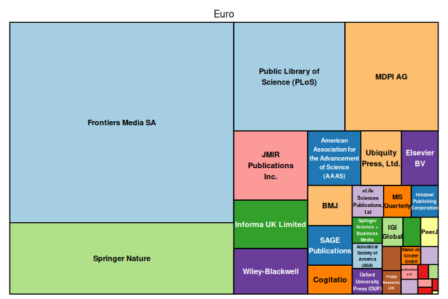
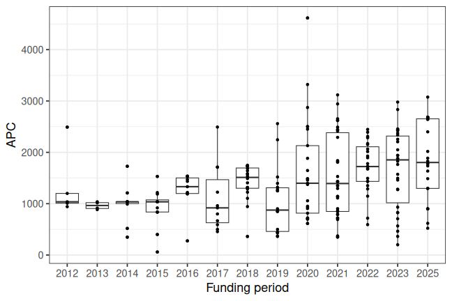
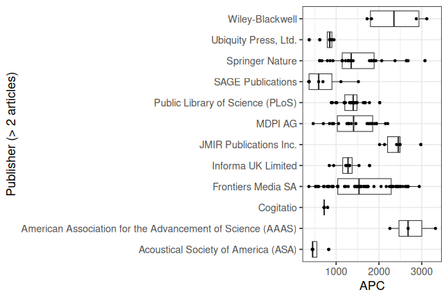

The [University of Zurich](https://www.uzh.ch/en.html) has updated its APC and BPC expenditures, the recent contribution provides data for the 2025 period.

The [University Library Zurich](https://www.ub.uzh.ch/en/wissenschaftlich-arbeiten/publizieren/Publikation-finanzieren.html) collects data on institutional APC and BPC expenditures and kindly provides them to OpenAPC.

Contact via the [Open Science Services](mailto: oa@ub.uzh.ch).

## Cost data

The new data set covers publication fees for 24 articles published in 2025. Total expenditure amounts to 44,746€ and the average fee is 1,864€. The following table provides an overview of the new APC data. Please note that BPCs are not included in this list, as they are aggregated in OpenAPC's [BPC](https://github.com/OpenAPC/openapc-de/blob/master/data/bpc.csv) dataset.

|                                                           | Articles| Fees paid in EURO| Mean Fee paid|
|:----------------------------------------------------------|--------:|-----------------:|-------------:|
|Springer Nature                                            |        7|             16534|          2362|
|Frontiers Media SA                                         |        5|              9771|          1954|
|Public Library of Science (PLoS)                           |        3|              5430|          1810|
|Ubiquity Press, Ltd.                                       |        3|              2418|           806|
|American Association for the Advancement of Science (AAAS) |        1|              2681|          2681|
|BMJ                                                        |        1|              2681|          2681|
|IGI Global                                                 |        1|              1736|          1736|
|MDPI AG                                                    |        1|              1298|          1298|
|Österreichische Akademie der Wissenschaften                |        1|               900|           900|
|Philosophy Documentation Center                            |        1|              1296|          1296|

## Overview

With the recent contribution included, the overall APC data for the University of Zurich now looks as follows:

### Fees paid per publisher (in EURO)

###  Average costs per year (in EURO)

###  Average costs per publisher (in EURO)

