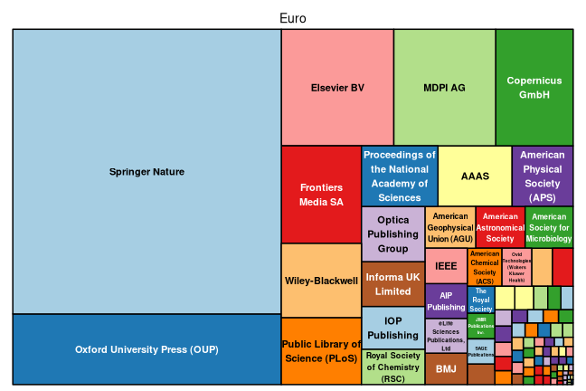
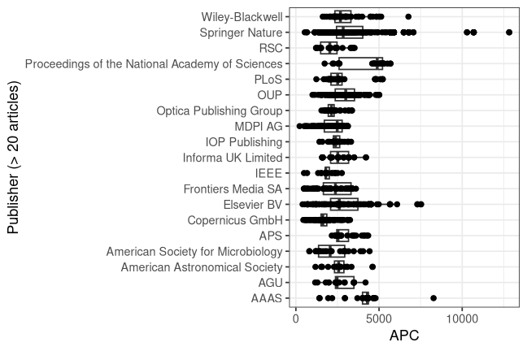

The [Couperin consortium](https://couperin.org) collects data on APC expenditures from universities and other research institutions in France. 

APC expenditures for 29 institutions have now been made available to OpenAPC.

Contact person for Couperin is [Valerie Larroque](mailto:apc@couperin.org).

## Cost data

The new data set provided by Couperin covers publication fees for 1,971 articles, total expenditure amounts to 5,535,227€ and the average fee is 2,808€. 

The data originates from the following institutions:

- Aix-Marseille Université
- ANSM - Agence Nationale de Sécurité des Médicaments et des produits de santé
- Université Clermont Auvergne
- Université Marie et Louis Pasteur
- Université Bordeaux Montaigne
- CEA - Commissariat à l'énergie atomique et aux énergies alternatives
- Ecole centrale de Lyon
- CNRS - Centre national de la recherche scientifique
- Université Côte d'Azur - UniCA
- Université de Haute-Alsace
- HCL - Hospices civils de Lyon
- IMTBS - Télécom SudParis & Institut Mines-Télécom Business School (**new**)
- Le Mans Université
- Université de Limoges
- Université de Lorraine
- Université Lumière - Lyon II
- Université Jean Moulin - Lyon III
- MNHN - Muséum National d'Histoire Naturelle
- Université Sorbonne Nouvelle - Paris III - USN
- Université Paris Cité
- Université Paris-Dauphine - Paris IX
- Université de Rennes II Haute-Bretagne
- Université de La Réunion
- La Rochelle Université
- Université Toulouse - Jean Jaurès
- Université de Bretagne Occidentale - UBO
- Université de Bretagne Sud - UBS
- Université du Littoral Côte d'Opale

## Overview

A detailed analysis of the contributed data sets provides the following overview:

### Breakdown by publisher

|                                                                                                    | Articles| Fees paid in EURO| Mean Fee paid|
|:---------------------------------------------------------------------------------------------------|--------:|-----------------:|-------------:|
|Springer Nature                                                                                     |      608|           2124884|          3495|
|Oxford University Press (OUP)                                                                       |      177|            527156|          2978|
|MDPI AG                                                                                             |      148|            329878|          2229|
|Copernicus GmbH                                                                                     |      147|            251274|          1709|
|Elsevier BV                                                                                         |      124|            364742|          2941|
|Frontiers Media SA                                                                                  |       93|            217505|          2339|
|Wiley-Blackwell                                                                                     |       54|            165274|          3061|
|Public Library of Science (PLoS)                                                                    |       52|            149385|          2873|
|Optica Publishing Group                                                                             |       44|             97436|          2214|
|American Physical Society (APS)                                                                     |       36|            102836|          2857|
|AAAS                                                                                                |       31|            125014|          4033|
|Informa UK Limited                                                                                  |       31|             79262|          2557|
|IOP Publishing                                                                                      |       31|             75568|          2438|
|Proceedings of the National Academy of Sciences                                                     |       30|            128830|          4294|
|Royal Society of Chemistry (RSC)                                                                    |       29|             62124|          2142|
|American Society for Microbiology                                                                   |       25|             55774|          2231|
|IEEE                                                                                                |       23|             41683|          1812|
|American Astronomical Society                                                                       |       22|             57389|          2609|
|American Geophysical Union (AGU)                                                                    |       22|             58890|          2677|
|American Chemical Society (ACS)                                                                     |       18|             36737|          2041|
|eLife Sciences Publications, Ltd                                                                    |       18|             40581|          2255|
|AIP Publishing                                                                                      |       16|             41188|          2574|
|EDP Sciences                                                                                        |       15|             12259|           817|
|BMJ                                                                                                 |       11|             37052|          3368|
|SAGE Publications                                                                                   |       10|             19179|          1918|
|The Royal Society                                                                                   |       10|             20554|          2055|
|Bio-Protocol, LLC                                                                                   |        9|              9299|          1033|
|JMIR Publications Inc.                                                                              |        9|             19741|          2193|
|Ovid Technologies (Wolters Kluwer Health)                                                           |        9|             31388|          3488|
|Cambridge University Press (CUP)                                                                    |        8|             21871|          2734|
|American Medical Association (AMA)                                                                  |        6|             22056|          3676|
|Pensoft Publishers                                                                                  |        6|              5616|           936|
|Acoustical Society of America (ASA)                                                                 |        5|              7817|          1563|
|American Meteorological Society                                                                     |        4|              7721|          1930|
|Society for Neuroscience                                                                            |        4|             12982|          3246|
|American Society for Clinical Investigation                                                         |        3|             15799|          5266|
|American Society of Hematology                                                                      |        3|              8020|          2673|
|Association for Research in Vision and Ophthalmology (ARVO)                                         |        3|              5120|          1707|
|MIT Press                                                                                           |        3|              4202|          1401|
|S. Karger AG                                                                                        |        3|              8546|          2849|
|SPIE-Intl Soc Optical Eng                                                                           |        3|              3585|          1195|
|Ubiquity Press, Ltd.                                                                                |        3|              2234|           745|
|Walter de Gruyter GmbH                                                                              |        3|              4060|          1353|
|American Psychological Association (APA)                                                            |        2|              5131|          2565|
|Caltech Library                                                                                     |        2|               529|           264|
|Cold Spring Harbor Laboratory Press                                                                 |        2|              5734|          2867|
|David Publishing Company                                                                            |        2|               954|           477|
|Fortune Journals                                                                                    |        2|              3413|          1706|
|Ivyspring International Publisher                                                                   |        2|              5220|          2610|
|Juniper Publishers                                                                                  |        2|              3798|          1899|
|Life Science Alliance, LLC                                                                          |        2|              4801|          2400|
|MyJove Corporation                                                                                  |        2|              5407|          2703|
|Scientific Societies                                                                                |        2|              6733|          3367|
|The Company of Biologists                                                                           |        2|              6730|          3365|
|AccScience Publishing                                                                               |        1|              2308|          2308|
|American Association for Cancer Research (AACR)                                                     |        1|              6640|          6640|
|American Physiological Society                                                                      |        1|               863|           863|
|Auctores Publishing LLC                                                                             |        1|              2231|          2231|
|Avens Publishing Group                                                                              |        1|               321|           321|
|BioResources                                                                                        |        1|               760|           760|
|Brill                                                                                               |        1|              2400|          2400|
|Canadian Science Publishing                                                                         |        1|              1458|          1458|
|Directive Publications                                                                              |        1|              1085|          1085|
|European Association of Geochemistry                                                                |        1|              1250|          1250|
|European Respiratory Society (ERS)                                                                  |        1|              1185|          1185|
|Ferrata Storti Foundation (Haematologica)                                                           |        1|              2302|          2302|
|Gavin Publishers                                                                                    |        1|              2968|          2968|
|Georg Thieme Verlag KG                                                                              |        1|              2875|          2875|
|IMR Press                                                                                           |        1|              1974|          1974|
|Inter-Research Science Center                                                                       |        1|              2500|          2500|
|International Union Against Tuberculosis and Lung Disease                                           |        1|              2125|          2125|
|International Union of Crystallography (IUCr)                                                       |        1|               597|           597|
|JLE                                                                                                 |        1|               398|           398|
|Manchester University Press                                                                         |        1|              2303|          2303|
|Mary Ann Liebert Inc                                                                                |        1|              3348|          3348|
|Maximum Academic Press                                                                              |        1|              2525|          2525|
|Microbiology Society                                                                                |        1|              2520|          2520|
|MIT Press - Journals                                                                                |        1|              1900|          1900|
|Opast Group LLC                                                                                     |        1|              2156|          2156|
|PAGEPress Publications                                                                              |        1|               832|           832|
|Partners in Digital Health                                                                          |        1|               574|           574|
|PeerJ                                                                                               |        1|              1718|          1718|
|Polska Akademia Nauk Instytut Paleobiologii (Institute of Paleobiology, Polish Academy of Sciences) |        1|               349|           349|
|Regional Euro-Asian Biological Invasions Centre Oy (REABIC)                                         |        1|              1330|          1330|
|Rockefeller University Press                                                                        |        1|              5692|          5692|
|Scientific Research Publishing, Inc.                                                                |        1|               249|           249|
|Scientific Scholar                                                                                  |        1|               255|           255|
|Society of Nuclear Medicine                                                                         |        1|              2979|          2979|
|Stichting Nase                                                                                      |        1|              2000|          2000|
|University of Sciences, Techniques and Technologies of Bamako                                       |        1|               600|           600|
|University of Uludag                                                                                |        1|              2400|          2400|
|University of Wisconsin Press                                                                       |        1|              1951|          1951|
|Verein zur Forderung des Open Access Publizierens in den Quantenwissenschaften                      |        1|               600|           600|
|Zoological Research                                                                                 |        1|              1744|          1744|

### Fees paid per publisher (in EURO)

###  Average costs per publisher (in EURO)

