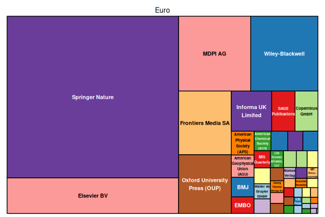
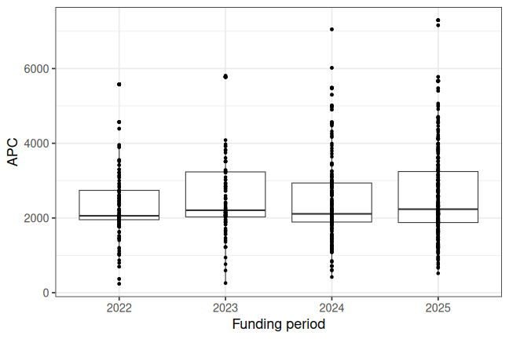
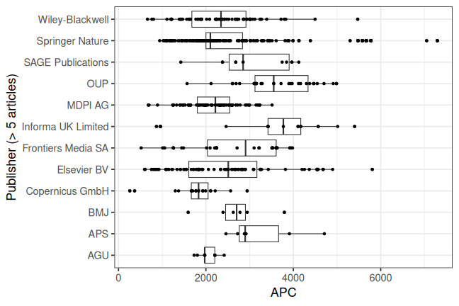

---

layout:     post
author:     Julia Bartlewski
author_lnk: https://github.com/jbartlewski
title:      Koeln U reports its 2025 expenditures
date:       2026-11-26 10:00:00
summary:    
categories: [general, openAPC]
comments: true
---

The [Universität zu Köln](https://ub.uni-koeln.de/en/publishing-research/publikationsfonds) has updated its expenditures, providing data on APCs, BPCs and TAs for the 2025 period.

Contact person for the data set is [Inga Frieman](mailto:frieman@ub.uni-koeln.de).

## Cost data

The new data covers APCs for 367 articles (168 unrelated to any agreement, 199 published under an agreement like DEAL). Total APC expenditure amounts to 965,572€ and the average fee is 2,631€.

The following table provides an overview.  

|                                                                        | Articles| Fees paid in EURO| Mean Fee paid|
|:-----------------------------------------------------------------------|--------:|-----------------:|-------------:|
|Springer Nature                                                         |      117|            318787|          2725|
|MDPI AG                                                                 |       51|             99542|          1952|
|Elsevier BV                                                             |       39|             93908|          2408|
|Wiley-Blackwell                                                         |       39|             87879|          2253|
|Frontiers Media SA                                                      |       22|             59707|          2714|
|Oxford University Press (OUP)                                           |       20|             73305|          3665|
|Informa UK Limited                                                      |       12|             42485|          3540|
|Copernicus GmbH                                                         |        9|             17060|          1896|
|SAGE Publications                                                       |        7|             23927|          3418|
|American Physical Society (APS)                                         |        5|             16878|          3376|
|American Geophysical Union (AGU)                                        |        4|              8569|          2142|
|American Chemical Society (ACS)                                         |        3|             12035|          4012|
|BMJ                                                                     |        3|              7782|          2594|
|American Association for the Advancement of Science (AAAS)              |        2|              8127|          4064|
|American Meteorological Society                                         |        2|              2642|          1321|
|American Society for Clinical Investigation                             |        2|             10804|          5402|
|American Society of Hematology                                          |        2|              6450|          3225|
|Institute for Operations Research and the Management Sciences (INFORMS) |        2|              6386|          3193|
|Institute of Electrical & Electronics Engineers (IEEE)                  |        2|              4935|          2468|
|JMIR Publications Inc.                                                  |        2|              4380|          2190|
|Nomos Verlag                                                            |        2|              4736|          2368|
|Proceedings of the National Academy of Sciences                         |        2|             10689|          5344|
|Walter de Gruyter GmbH                                                  |        2|              5424|          2712|
|American Astronomical Society                                           |        1|              1856|          1856|
|American Medical Association (AMA)                                      |        1|              3424|          3424|
|American Physiological Society                                          |        1|              1137|          1137|
|Hapres                                                                  |        1|              1293|          1293|
|Life Science Alliance, LLC                                              |        1|              3856|          3856|
|MIS Quarterly                                                           |        1|              5066|          5066|
|MIT Press - Journals                                                    |        1|              1951|          1951|
|Modestum Limited                                                        |        1|              1654|          1654|
|Österreichische Akademie der Wissenschaften                             |        1|              1071|          1071|
|Ovid Technologies (Wolters Kluwer Health)                               |        1|              1915|          1915|
|Quintessence Publishing                                                 |        1|              1488|          1488|
|Royal Society of Chemistry (RSC)                                        |        1|              3357|          3357|
|Schweizerbart                                                           |        1|              2600|          2600|
|Scientific Societies                                                    |        1|              3837|          3837|
|Society for Neuroscience                                                |        1|              1919|          1919|
|Ubiquity Press, Ltd.                                                    |        1|              2712|          2712|

## Overview

With the recent contribution included, the overall APC data for the Universität zu Köln now looks as follows:

### Fees paid per publisher (in EURO)

###  Average costs per year (in EURO)

###  Average costs per publisher (in EURO)

