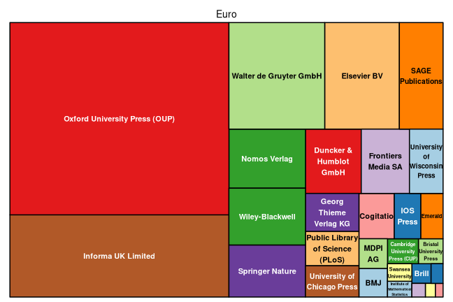
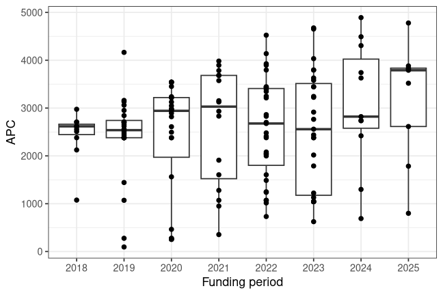
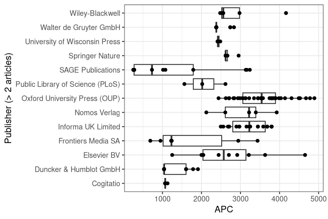

The [IAB (Institut für Arbeitsmarkt- und Berufsforschung)](http://www.iab.de/en) has updated its APC expenditures, the latest contribution provides data for the 2025 period.

The IAB is a research institute and special office of the German Federal Employment Agency.

Contact person for the IAB data is [Ralf-Bernhard Riebau](mailto:Ralf-Bernhard.Riebau@iab.de).

## Cost Data

The new dataset covers publication fees for 9 articles, total expenditure amounts to 28,819€ and the average fee is 3,202€.

The following table shows the payments the IAB has made to publishers in 2024.

|                                 | Articles| Fees paid in EURO| Mean Fee paid|
|:--------------------------------|--------:|-----------------:|-------------:|
|Oxford University Press (OUP)    |        6|             23621|          3937|
|Duncker & Humblot GmbH           |        1|              1785|          1785|
|Public Library of Science (PLoS) |        1|              2614|          2614|
|Verlag Barbara Budrich GmbH      |        1|               799|           799|

## Overview

With the recent contribution included, the overall APC data for the IAB now looks as follows:

### Fees paid per publisher (in EURO)

###  Average costs per year (in EURO)

###  Average costs per publisher (in EURO)

